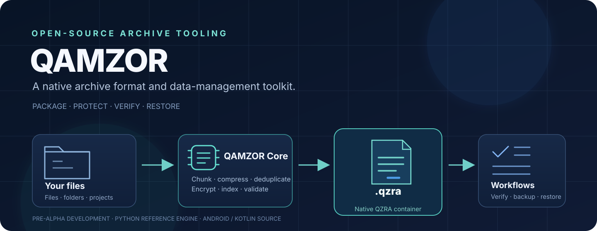
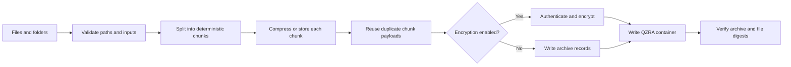

<div align="center">
  

  <h1>QAMZOR</h1>
  <p><strong>A native archive format and data-management toolkit.</strong></p>
  <p>Package files into QZRA archives. Verify integrity. Protect private data. Manage snapshots and recovery workflows.</p>

  <p>
    <a href="https://github.com/ibra8y3-web/QAMZOR/actions/workflows/platform-builds.yml"></a>
    <a href="https://img.shields.io/github/license/ibra8y3-web/QAMZOR"></a>
    
    
  </p>

  <p>
    <a href="#features">Features</a> ·
    <a href="#quick-start">Quick start</a> ·
    <a href="#android">Android</a> ·
    <a href="#security">Security</a> ·
    <a href="#documentation">Documentation</a> ·
    <a href="#contributing">Contributing</a>
  </p>
</div>

---

## What is QAMZOR?

**QAMZOR** is an open-source archive and data-management project built around its own container format: **QZRA (`.qzra`)**.

The project brings together a Python reference engine and CLI, plus Kotlin source projects for Android, desktop, and an SDK. The Python implementation focuses on real archive operations: chunking, compression, deduplication, integrity verification, encryption, signatures, recovery, snapshots, and cloud-provider adapters.

QAMZOR is actively evolving. It is currently **pre-alpha development software**, not a production-audited replacement for a mature backup system. Platform capabilities and test status are documented separately below so that source-code work is not confused with a verified release.

## At a glance

| Area | What it provides | Current status |
|---|---|---|
| QZRA format | A versioned archive container for files and folders | Implemented in the Python reference engine |
| Python Core and CLI | Create, inspect, verify, search, preview, compare, extract, sign, recover, and manage snapshots | Main executable reference implementation |
| Encryption | AES-256-GCM with scrypt-based key derivation; QZRA 1.3 can encrypt the manifest | Implemented in the Python reference engine; client-platform acceptance is tracked separately |
| Backup repositories | Immutable snapshots, content-addressed objects, restore, retention, and deltas | Python implementation |
| Cloud adapters | WebDAV, Google Drive, Dropbox, OneDrive, and S3-compatible storage | Python CLI/Core only; live third-party account testing is not claimed |
| Android | Native app source with a phone file browser and in-place archive/encrypt workflow in the latest development changelog | Development source; Gradle/JUnit/APK acceptance still required |
| Desktop and Kotlin SDK | JVM desktop and shared Kotlin modules | Development source; verify the Platform Builds workflow before treating distributions as release-ready |

## Features

### Archive engine

- **Native `.qzra` containers** with documented, versioned format rules.
- **Content-defined chunking** with deterministic boundaries.
- **Adaptive compression** per chunk using zlib/DEFLATE or storing the chunk unchanged when compression would make it larger.
- **Deduplication** of identical chunks within an archive, plus content-addressed object reuse across repository snapshots.
- **Bounded parallel compression workers** to limit queued work and memory pressure.
- **SHA-256 integrity checks** for chunks and reconstructed files.
- **Safe extraction controls**, including file-count and total-byte limits, path validation, and atomic output publication.

### Privacy and authenticity

- **AES-256-GCM encryption** with scrypt-derived keys for supported encrypted archive versions.
- **QZRA 1.3 encrypted manifest** to conceal names, paths, sizes, digests, and the true entry count.
- **Independent protected-folder scopes** in the Python reference implementation, with a configurable maximum of 32 scopes.
- **Detached Ed25519 signatures** for archive authenticity when the verification public key is obtained through a trusted channel.
- Passwords are not recoverable. Losing an archive password can make the protected data inaccessible.

### Archive and backup workflows

- Virtual archive search and bounded previews without extracting every entry.
- Full extraction or extraction of a selected file/folder subtree.
- Archive comparison by path, type, size, and digest metadata.
- Split large archives into volumes and reassemble them with integrity checks.
- XOR recovery sidecars for limited single-block recovery.
- Local snapshot repositories with verification, restore, retention planning, and garbage collection.
- Direct-child repository delta export and application.
- Smart exclusions using command-line patterns and `.qzignore` files.
- Bounded text extraction for supported Office files in the Python preview workflow.
- Python job API for queued archive-creation jobs with progress and checkpoint-based pause/resume/cancel.

### Platform boundaries

A feature available in the Python CLI is **not automatically available in the Android or desktop UI**. In particular, cloud-provider login/sync, the Python Job Center, repository management, signatures, and recovery workflows should not be assumed to exist in the Android app unless a platform-specific implementation and its tests are documented.

## How QZRA works

The following is a conceptual view of the Python archive pipeline. Optional encryption and metadata hiding depend on the selected QZRA version and command options.



### QZRA format generations

| Version | Main capability | Notes |
|---|---|---|
| QZRA 1.0 | Legacy archive entries | Retained for compatibility by the Python reference reader/writer |
| QZRA 1.1 | Chunked archive layout | Content-defined chunks, adaptive zlib/store coding, and deduplicated payload references |
| QZRA 1.2 | Authenticated encryption | AES-256-GCM protected payloads and authenticated manifest; metadata remains visible |
| QZRA 1.3 | Encrypted metadata | Encrypts the complete manifest; Python implementation also supports independent protected-folder scopes |

See the [QZRA format specification](docs/QZRA_FORMAT.md) for the binary layout and compatibility details.

## Quick start

### Requirements

- Python **3.10 or newer**.
- For unencrypted QZRA 1.0/1.1 operations, the Python standard library is sufficient.
- Install the optional `cryptography` dependency for encryption and Ed25519 signing.

### Install from source

```bash
git clone https://github.com/ibra8y3-web/QAMZOR.git
cd QAMZOR

# Install the package and CLI
python -m pip install -e .

# Optional: enable encryption and Ed25519 signing
python -m pip install -e ".[crypto]"

# Check the command-line interface
qz --help
```

### Create and inspect an archive

```bash
# Package a folder into a native QZRA archive
qz convert project.qzra ./project --profile balanced --workers 2

# List entries and inspect archive metadata
qz list project.qzra
qz inspect project.qzra

# Verify every file and its integrity digests
qz verify project.qzra

# Search and preview an entry without extracting the entire archive
qz search project.qzra README --kind file
qz preview project.qzra project/README.md --max-bytes 65536

# Extract everything, or only one selected file
qz extract project.qzra --output ./restored
qz extract project.qzra --output ./selected --file project/README.md
```

### Encrypt an archive

```bash
# QZRA 1.2: encrypt archive payloads; manifest names remain visible
qz create private-v12.qzra ./private --encrypt

# QZRA 1.3: encrypt the complete manifest and hide file metadata
qz create private-v13.qzra ./private --hide-metadata

# Give an archive-relative folder its own password scope
qz create protected.qzra ./Project --protect-folder 'Project/Finance'
```

The CLI prompts for passwords rather than requiring them as command-line arguments. For automated workflows, use protected password files and keep them outside source control. See the security documentation before storing sensitive data.

### Sign and recover

```bash
# Generate an encrypted Ed25519 signing key pair
qz keygen --private-key signing-private.pem --public-key signing-public.pem

# Sign an archive and verify it against a trusted public key
qz sign project.qzra --private-key signing-private.pem
qz verify-signature project.qzra --public-key signing-public.pem --signature project.qzra.qzsig

# Create a recovery sidecar, then repair into a separate output archive
qz recover create project.qzra --output project.qzra.qzrec
qz recover repair damaged.qzra project.qzra.qzrec --output project.repaired.qzra
```

XOR recovery can repair **at most one damaged block per parity group**. It is not multi-error Reed–Solomon recovery and does not replace independent backups.

### Local snapshots

```bash
qz repo init ./backup.qamzor
qz repo snapshot ./backup.qamzor ./project --message "before update"
qz repo list ./backup.qamzor
qz repo verify ./backup.qamzor
qz repo restore ./backup.qamzor SNAPSHOT_ID --output ./restored

# Preview a retention plan; add --apply only when ready to execute it
qz repo prune ./backup.qamzor --keep-last 10

# Export/apply a direct-child delta when the exact base snapshot exists
qz repo export-delta ./backup.qamzor BASE_SNAPSHOT_ID TARGET_SNAPSHOT_ID --output update.qzd
qz repo apply-delta ./restored-backup.qamzor update.qzd
```

### Other useful commands

```bash
# Exclude generated files from an archive
qz convert clean.qzra ./Project --exclude 'build/' --exclude '*.tmp'
qz convert clean.qzra ./Project --exclude-from ./exclude-rules.txt

# Compare two archives by metadata and file digests
qz compare old.qzra new.qzra

# Split and reassemble a large archive
qz split backup.qzra ./backup-volumes --part-size-mib 100
qz join ./backup-volumes/backup.qzra.qzset ./backup-restored.qzra

# Preview text from supported Office documents (Python CLI)
qz preview documents.qzra Project/Report.docx --office
```

Compression profiles are `speed` (zlib level 1), `balanced` (level 6), and `maximum` (level 9). A chunk is stored unchanged whenever compression would not reduce its size.

## Cloud storage adapters

The Python CLI contains development adapters for:

- Google Drive API v3
- Dropbox API v2
- Microsoft Graph OneDrive
- AWS S3 and S3-compatible object storage
- WebDAV-compatible HTTPS storage

These adapters use credentials supplied at runtime. They do **not** provide an Android cloud-sync interface or a complete interactive OAuth sign-in/refresh flow. The project has not claimed successful end-to-end testing against a user's live cloud account.

Example using an already-issued Google Drive access token:

```bash
export QAMZOR_GOOGLE_DRIVE_ACCESS_TOKEN="YOUR_SHORT_LIVED_TOKEN"
qz cloud-provider push google-drive backup.qzra
```

For S3-compatible storage, supply the bucket, region, access key, secret key, and optional endpoint through environment variables. Never commit credentials, tokens, `.env` files, or private keys to the repository.

See [Cloud connectors](docs/CLOUD_CONNECTORS.md) for permissions, environment variables, and restore behavior.

## Android

The latest development changelog describes an Android file-browser and in-place archive workflow:

- Browse internal shared storage and an SD card from the app.
- Select files and folders from the device browser.
- Create a `.qzra` file beside the selected source item.
- Open a QZRA file from QAMZOR or a compatible file manager, then browse, restore, or run an integrity check.
- The development encryption flow uses QZRA 1.3 metadata hiding and requests an archive password.

> [!CAUTION]
> **The in-place Archive/Encrypt action is destructive by design.** According to the current development changelog, the app verifies the new archive and checks the source before deleting the original item. A successful operation therefore leaves the archive in place of the original source. Keep a separate backup before using this workflow, especially while the Android build is still under development.

**Build and release status:** Android source and CI steps are present, but a successful Gradle build, APK artifact, unit-test run, and physical-device test must be confirmed in [Platform Builds](https://github.com/ibra8y3-web/QAMZOR/actions/workflows/platform-builds.yml). Do not treat the app as a verified release until those checks pass.

Android storage access also depends on the Android version and installation method. The current development changelog states that Android 11+ requires **All files access** (`MANAGE_EXTERNAL_STORAGE`), and that sideloaded builds are the intended distribution path. Review the permission prompt and Android release requirements before installing.

## Security model and limitations

QAMZOR includes defensive parsing and integrity checks, but it has **not** received an independent security audit. Important boundaries:

- QZRA 1.3 hides manifest metadata, but archive length and some access-pattern information can still be observable.
- QZRA 1.2 does not hide file names or manifest metadata.
- AES-GCM and Ed25519 depend on the installed `cryptography` implementation and sound password/key handling.
- A valid Ed25519 signature is meaningful only when the public key is trusted and verified through a separate channel.
- Cloud SHA-256 sidecars detect accidental corruption, but a party able to replace both an archive and its sidecar can replace the digest too. Use a detached signature when authenticity is required.
- XOR recovery is limited to one damaged block per parity group; it is not a substitute for tested independent backups.
- Password recovery is not supported.
- File permissions, ownership, timestamps, ACLs, and symbolic links are not preserved as ordinary archive contents; symbolic-link sources are rejected by the Python reference engine.
- The project is pre-alpha. Do not use it as the only copy of important data.

Read the full [security model](docs/SECURITY.md) before using encryption, signatures, recovery, or cloud storage.

## Tests and development status

Run the Python test suite from the repository root:

```bash
python -m pip install pytest
PYTHONPATH=src python -m pytest -q
```

The repository also contains Gradle modules for Kotlin Core, Android, desktop, and the SDK. Their build and test acceptance is tracked by the [Platform Builds workflow](https://github.com/ibra8y3-web/QAMZOR/actions/workflows/platform-builds.yml). A workflow definition is not proof that a build has passed; check its latest run and uploaded artifacts.

### Version-label note

The repository's current development labels are not fully synchronized: the latest `CHANGELOG.md` entry is `0.9.0-dev`, while the Python package metadata in `pyproject.toml` currently reports `0.7.2.dev0`. Until those are aligned, use the changelog and CI results for development history rather than treating either label as a stable public release number.

## Project structure

```text
QAMZOR/
├── androidApp/           # Android application source
├── core/                 # Shared Kotlin core source
├── desktopApp/            # JVM desktop application source
├── sdk/                  # Kotlin SDK source
├── src/qamzor/            # Python reference engine and CLI package
├── tests/                 # Python tests
├── docs/                  # Format, security, product, and API documentation
├── fixtures/              # Cross-implementation test fixtures
├── tools/                 # Benchmarks and developer utilities
├── benchmark-results/     # Recorded benchmark outputs
├── .github/workflows/     # CI workflows
├── ARCHITECTURE.md
├── CHANGELOG.md
├── CONTRIBUTING.md
├── ROADMAP.md
├── STATUS.md
└── README.md
```

## Documentation

| Document | Description |
|---|---|
| [Architecture](ARCHITECTURE.md) | Current components, engines, and target architecture |
| [QZRA format](docs/QZRA_FORMAT.md) | Archive format and binary layout |
| [Repository format](docs/REPOSITORY_FORMAT.md) | Snapshot and delta storage design |
| [Security model](docs/SECURITY.md) | Threat model, guarantees, and limitations |
| [Product feature matrix](docs/PRODUCT_FEATURES.md) | Python capabilities vs. platform UI integration |
| [Cloud connectors](docs/CLOUD_CONNECTORS.md) | Provider permissions, credentials, and operations |
| [Job Center API](docs/JOB_CENTER_API.md) | Python background-job API |
| [Changelog](CHANGELOG.md) | Development history |
| [Roadmap](ROADMAP.md) | Gated project milestones |
| [Status](STATUS.md) | Recorded implementation and test evidence |
| [Contributing](CONTRIBUTING.md) | How to contribute |

## Contributing

Contributions, bug reports, documentation fixes, and reproducible test cases are welcome. Please read [CONTRIBUTING.md](CONTRIBUTING.md) before opening a pull request.

For security-sensitive issues, avoid posting exploit details or private data in a public issue. Follow the repository's security policy where available.

## License

QAMZOR is distributed under the **Apache License 2.0**. See [LICENSE](LICENSE).

---

<div align="center">
  <sub>QAMZOR · Open archive tooling built around the QZRA format · Pre-alpha development</sub>
</div>
